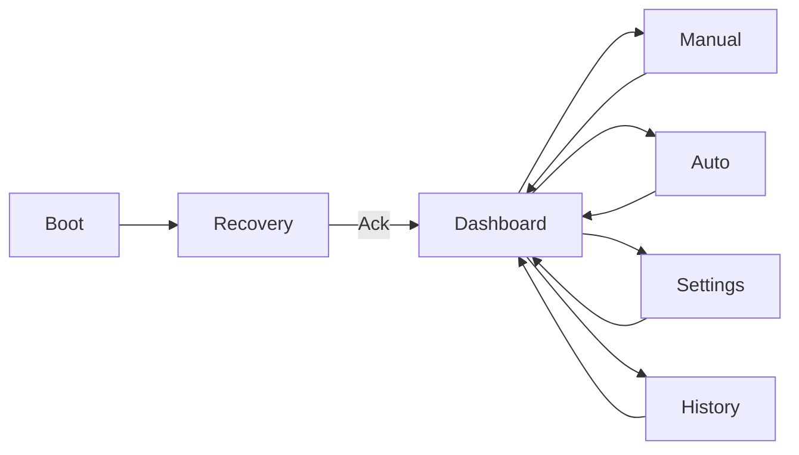

# LVGL UI Specification

## Foundation

| Item | Value |
|------|-------|
| Resolution | **1024 × 600** |
| LVGL | **8.4.0** (existing `lvgl_port`) |
| Rotation | 0° |
| Integration | Keep `lvgl_port_init`, mutex `lvgl_port_lock` / `unlock` |
| Demo UI | SquareLine demo removed; production HMI lives under `main/hmi/` |

## Visual direction

- Dark industrial theme, high contrast.
- Large touch targets (≥ 64 px height primary buttons where practical).
- Clear Running / Stopped / Paused / Fault / Recovery states.
- Minimal navigation depth (one-level bottom or side nav).
- Avoid decorative animations and high-rate full-screen invalidation.
- Distinguish **commanded** output state from verified feedback (none in v1).

### Color tokens (proposed)

| Token | Hex | Use |
|-------|-----|-----|
| `bg` | `#1A1D23` | Screen background |
| `panel` | `#242830` | Section panels |
| `text` | `#E8EAED` | Primary text |
| `muted` | `#9AA0A6` | Secondary text |
| `accent` | `#3D8BFF` | Selection / links |
| `run` | `#2E7D32` | Running |
| `stop` | `#5F6368` | Stopped / idle |
| `pause` | `#F9A825` | Paused |
| `fault` | `#C62828` | Fault |
| `warn` | `#EF6C00` | Recovery / caution |

### Typography

- Prefer existing Montserrat sizes enabled in `sdkconfig.defaults` (12/16/20/24/44).
- Status values: large (24–44).
- Labels: 16–20.
- Avoid dense 12 px body for primary controls.

## Screens

### 1. Recovery (boot gate)

**Purpose:** Force inspection after every power-up / E-stop restore.

**Content:**

- Title: Power Restored / Recovery Required
- Checklist text: inspect press position, dough path, guards, air pressure, E-stop reset
- Button: **Machine Inspected — Continue**
- Until acknowledged: navigation to Manual/Auto disabled; Settings/History may be read-only or allowed (Settings edit allowed; machine start blocked)

**Exit:** Sets `recovery_unlocked = true`, loads Dashboard.

### 2. Dashboard

**Content:**

- Machine status (Idle / Running / Paused / Completed / Fault / Recovery locked)
- Operating mode (Manual / Automatic / None)
- Production counter / target
- Current process step name
- Progress bar (quantity and/or step)
- Start / Pause / Resume / Stop
- Nav: Manual, Auto, Settings, History

Start from Dashboard enters Automatic only if unlocked and settings valid.

### 3. Manual Control

**Controls:**

| Group | Actions |
|-------|---------|
| Mixer | ON / OFF |
| Door | OPEN / CLOSE |
| Press | FORWARD / REVERSE (momentary or pulse per settings; mutex) |
| Cutter | EXTEND / RETRACT |
| Conveyor | ON / OFF |
| Flattener | EXTEND / RETRACT |

**Requirements:**

- Disabled entirely while Automatic running or Recovery locked.
- Show commanded ON/OFF indicators per output.
- Confirmation modal for press, cutter, door.
- Cannot assert R3 and R4 together.

### 4. Automatic Production

- Target / current / remaining quantity
- Current step + progress
- Start / Pause / Resume / Stop
- Link to Settings for timings/target

### 5. Machine Settings

Editable numeric fields (see Settings spec):

- All stage durations
- Target quantity
- Save / Load (load at boot automatic) / Restore defaults
- Validation with min/max; reject Save on invalid

### 6. Production History

- Last run quantity
- Total completed forming cycles (lifetime counter)
- Last production duration
- Last production date/time (RTC if available; else uptime-based stamp noted as limited)

## Navigation

No deep stacks. Back always returns to Dashboard (or Recovery if still locked — should not happen after ack).

## Touch interaction

- Single tap primary.
- Debounce via LVGL + ignore commands while modal open.
- Dangerous actions: confirm + hold optional later; v1 = confirm dialog.
- While Recovery locked, Manual/Auto entry shows toast/dialog explaining unlock required.

## UI state management

| Rule | Detail |
|------|--------|
| No actuator writes in LVGL event callbacks | Callbacks enqueue `machine_cmd_t` only |
| Status refresh | 5–10 Hz max from status snapshot under LVGL lock |
| Mode exclusion | UI disables illegal buttons based on snapshot flags |
| Fault | Banner + Fault color; clear only via documented path |
| Language | English v1 (demo Chinese font unused for machine UI) |

## Components

- Status header bar (status + mode + clock if available)
- Primary button row (Start/Pause/Resume/Stop)
- Step label + progress bar
- Numeric stepper / spinbox for settings
- Modal confirm
- Nav bar

## Related

- [FIRMWARE_ARCHITECTURE.md](FIRMWARE_ARCHITECTURE.md)
- [MACHINE_SEQUENCE.md](MACHINE_SEQUENCE.md)
- [SAFETY_AND_FAULT_HANDLING.md](SAFETY_AND_FAULT_HANDLING.md)
