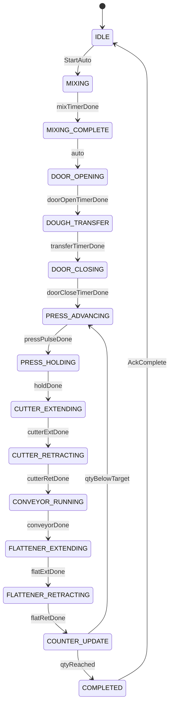

# Machine Sequence and State Machine

## Operating modes

| Mode | Behavior |
|------|----------|
| Recovery locked | After every boot/power restore until operator acknowledges Recovery screen |
| Manual | Individual actuator commands with interlocks |
| Automatic | Full production sequence to target quantity |
| Fault | Outputs safe; requires clear/ack path |

## High-level process

### Stage A — Mixing and dough transfer

1. Operator sets target quantity (Settings / Auto screen).
2. Operator starts Automatic (only if Recovery unlocked).
3. Mixer ON for `mixing_duration_ms`.
4. Mixer OFF.
5. Door extend for `door_open_duration_ms`.
6. Optional transfer dwell `dough_transfer_duration_ms` (door remains commanded open).
7. Door retract (de-energize R2) for `door_close_duration_ms`.
8. Initialize forming counter to 0 for this run.

### Stage B — Repeating forming cycle

Until `current_quantity >= target_quantity`:

1. **Press advance** — R3 ON for `press_advancement_duration_ms`, then R3/R4 OFF; wait `press_hold_duration_ms` (commanded hold).
2. **Cut** — R5 ON `cutter_extend_duration_ms`, OFF, wait `cutter_return_duration_ms`.
3. **Convey** — R6 ON `conveyor_duration_ms`, then OFF.
4. **Flatten** — R7 ON `flattener_extend_duration_ms`, OFF, wait `flattener_return_duration_ms`.
5. **Count** — increment; if below target, repeat from step 1; else complete.

Press does **not** reverse each cycle. Accumulated advancement is preserved until an explicit reverse/reset (manual or future end-of-batch policy).

## State enumeration

| State | Description |
|-------|-------------|
| `MACHINE_IDLE` | Safe outputs; may be recovery-locked |
| `MACHINE_MIXING` | Mixer running |
| `MACHINE_MIXING_COMPLETE` | Mixer stopped; brief transit |
| `MACHINE_DOOR_OPENING` | Door extend commanded |
| `MACHINE_DOUGH_TRANSFER` | Door open dwell |
| `MACHINE_DOOR_CLOSING` | Door de-energized / close wait |
| `MACHINE_PRESS_ADVANCING` | Press forward pulse |
| `MACHINE_PRESS_HOLDING` | Both press solenoids OFF; commanded hold timer |
| `MACHINE_CUTTER_EXTENDING` | Cutter extend |
| `MACHINE_CUTTER_RETRACTING` | Cutter OFF + return wait |
| `MACHINE_CONVEYOR_RUNNING` | Conveyor ON |
| `MACHINE_FLATTENER_EXTENDING` | Flattener extend |
| `MACHINE_FLATTENER_RETRACTING` | Flattener OFF + return wait |
| `MACHINE_COUNTER_UPDATE` | Increment and decide next |
| `MACHINE_PAUSED` | Sequence frozen; see pause policy |
| `MACHINE_STOPPING` | Transition to safe idle |
| `MACHINE_COMPLETED` | Target reached; safe outputs |
| `MACHINE_FAULT` | Fault latched; safe outputs |

## Transition diagram (automatic)

Any active auto state → `PAUSED` on Pause; `PAUSED` → prior state on Resume (store `state_before_pause`).  
Any non-idle auto state → `STOPPING` → `IDLE` on Stop.  
Fault conditions → `FAULT`.

Timing uses **elapsed time** in `machine_task` (FreeRTOS tick / `esp_timer`), never LVGL refresh period.

## Pause behavior

Pause **blocks advancement to the next process state**. While paused:

| Subsystem | Policy |
|-----------|--------|
| Mixer | If pausing during mix: turn mixer **OFF** (do not leave motor spinning unattended) |
| Conveyor | Turn **OFF** |
| Door / cutter / flattener | De-energize spring-return valves (retract toward safe resting) |
| Press (R3/R4) | Both **OFF**; document that pneumatic motion may continue briefly; commanded hold only |
| Timers | Freeze remaining time for the interrupted step; resume continues remainder |

UI must not imply verified stopped cylinders.

## Stop behavior

Stop terminates automatic sequencing and drives **all outputs to safe idle** (see I/O table).

| Topic | Policy |
|-------|--------|
| Press position | Remains wherever pneumatics left it; **not** auto-homed |
| Remaining dough | Operator must clear/inspect before next Start |
| Counter | Retain last `current_quantity` for display; next Start begins a new run after confirmation |
| Mode | Return to IDLE; Manual allowed only if Recovery already unlocked |

## Completion

On target reached:

1. Enter `MACHINE_COMPLETED`.
2. All motor and valve outputs safe OFF.
3. HMI shows Production Complete.
4. Persist history record.
5. Operator acknowledges → `MACHINE_IDLE`.

## Recovery after E-stop / power loss

E-stop removes power including ESP32. On boot:

1. Outputs forced safe OFF.
2. Runtime sequence state discarded (no resume mid-cycle).
3. Settings/history load from NVS.
4. **Recovery screen** mandatory; Manual/Auto disabled until acknowledge.
5. Operator inspects press position, dough, guards → Acknowledge → IDLE unlocked.

## Manual mode notes

- One command path through actuator API with same interlocks.
- Hazardous moves (press, cutter, door) require confirmation dialog.
- Press Forward/Reverse buttons enforce mutex.
- Leaving Manual while an output is ON → force safe OFF on mode exit (except documented hold cases — default force OFF).

## Related

- [SETTINGS_SPECIFICATION.md](SETTINGS_SPECIFICATION.md)
- [SAFETY_AND_FAULT_HANDLING.md](SAFETY_AND_FAULT_HANDLING.md)
- [LVGL_UI_SPECIFICATION.md](LVGL_UI_SPECIFICATION.md)
